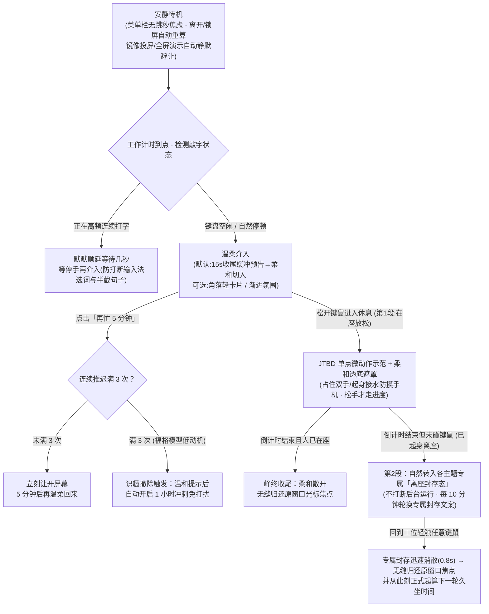

# MoveNow（动一下）产品设计与开发交接规范

> **交接说明（致新会话 Agent）**：本文档是经过完整产品访谈、六大经典方法论推导与开源定位打磨后达成的**终版共识**。旧仓库中的旧代码（`main.js`、`preload.js`、`screensaver/`、`assets/`、`start.command` 等）已被明确废弃，请**彻底推倒重做**（注意保留已更新的开源版 `README.md`，并在实现完成后按实际运行方式微调启动说明），严格按本规范直接交付第一版完整可用的产品。

---

## 一、产品核心定位与初衷（第一性原理）

MoveNow 的本质始终是一款**“极懂分寸（不招人烦却真能把人叫起来）+ 审美克制耐看（松弛平实、不卖萌抖机灵）”**的桌面防久坐健康伙伴。
- **彻底告别**：廉价 AI 塑料感卡通贴图、生硬突兀的纯色黑屏强锁、网络烂梗/AI 腔调/爹味说教、过度卖萌抖机灵、以及抓着鼠标戳泡泡之类的“伪休息”。
- **自然延伸的附带巧思（不喧宾夺主、不越界）**：当用户听劝起身离开工位（倒计时结束仍未碰键鼠）时，休息画面会自然过渡为与当前主题合一的**「离座封存态」**——顺手替离开座位的你遮住屏幕文字保护隐私，同时不像系统锁屏那样打断桌面上正在运行的程序（如正在执行的 AI Agent、编译或长任务）。
  - **严守边界原则**：一是不在一级面板增加独立的“主动锁屏/封存”按钮（避免偏离防久坐初衷变成锁屏工具）；二是**默认绝不干涉系统电源休眠策略**（「封存期间阻止系统空闲休眠」开关默认关闭，仅在二级设置中供有长任务保活需求的用户手动开启）。
- **跨平台策略**：第一阶段聚焦把 **macOS 独立桌面应用（`MoveNow.app`）** 体验打磨到极致（双击即用，告别脚本黑框）；同时将主题与状态层独立抽离，为后续平滑同步 Windows 做好架构预留。

---

## 二、全链路状态机与二段式专属封存闭环

---

## 三、核心产品机制与方法论红线（开发必守）

### 1. JTBD（用户任务理论）：化解“放下鼠标却低头刷手机”
- 内置微动作示范库优先采用**“自然占住双手或离开工位”**的零负担动作：
  - 双手十指交叉托后脑缓慢后仰
  - 双手背在身后舒展胸口与双肩
  - 端起水杯起身去接半杯水
  - 双手自然下垂，缓慢沉肩并望向窗外最远处
- 绝不做让人握着鼠标点击的小游戏；仅低频穿插平实提醒（如*“这几十秒也放过手机吧”*），严禁说教。

### 2. 斯坦福福格行为模型（$B = MAP$）：低动机时刻的“识趣退让”
- **顺手退路**：预告阶段与休息画面最顺手的一键操作均为**「再忙 5 分钟」**（瞬间归还屏幕，绝不耽误正事）。
- **防肌肉记忆秒关**：刚切入前 1.5~2 秒防残余按键误触；默认模式下彻底跳过本轮需**双击 `ESC`**（二级设置支持切换「宽松：单击/单按即退」与「严格：锁定不可跳过」）。
- **连推 3 次自动静默 1 小时**：连续点击「再忙 5 分钟」满 **3 次**，说明正处于高压救火状态。**严禁纠缠叹气或强行加码**，主动撤除触发，温和浮现一句*“看来手头正紧，我先安静 1 小时，忙完记得喝水”*后自动开启 **60 分钟免打扰**。

### 3. 知觉脱敏定律 × Hooked 多变酬赏：耐看百次不麻木
- **不越界窥探**：不做“深夜十一点还在加班”这类自作聪明的作息点评。
- **低频克制微彩蛋**：日常 90% 保持安静稳定；约 10% 低概率触发极克制的微细节变化（如几何生灵旁多了一杯冒热气的茶、简笔小动物换了打哈欠的小姿态），打破长期使用后的视觉脱敏。

### 4. Kano 反向需求 × 事前验尸法：第一版死守四条红线
1. **打字半截绝不抢焦点**：到点时若检测到最近 2 秒内仍有连续键盘输入（如正在打拼音选词），静默顺延等待停顿（兜底上限 15~20 秒）后再切入。
2. **防投屏汇报“社死”**：自动检测屏幕镜像投屏（Mirroring）或全屏演示状态并静默避让；菜单栏一级面板直出**一键「1 小时免打扰」**开关。
3. **默认静音防惊吓**：默认关闭所有声音（`soundEnabled: false`），仅在二级偏好页供用户主动开启。
4. **免敏感权限惊扰**：采用系统级窗口背景实时毛玻璃合成（`NSVisualEffectView` `behindWindow`），**绝不索要“屏幕录制（Screen Recording）”隐私权限**。

### 5. 卡尼曼峰终定律 × 离座专属封存机制
- **进入离座封存条件**：休息倒计时归零时，若检测到用户在休息期间/结束时未触碰键鼠（且「离座自动封存防窥」开关处于默认开启状态），无缝过渡进入当前主题专属的**第 2 段：离座封存态（Sealed Mode）**——仅作为休息结束后用户尚未回座的自然顺延保护，不设独立的手动锁屏入口，坚守防久坐工具本分。
- **可选的防休眠保活（默认关闭，不越界）**：二级偏好设置中提供「封存期间阻止系统自动休眠」开关，**默认关闭（`preventSleepDuringSeal: false`）**，绝不擅自接管系统电源管理；仅当用户主动开启时，才在封存期间创建 `IOPMAssertion`（带 2 小时安全上限）供长耗时 Agent/编译保活使用。
- **10 分钟文案柔和轮换**：在离座封存态下，每隔 **10 分钟**以柔和的淡出淡入动画切换下一句当前主题专属封存文案（底部附极淡常驻小字提示：*“轻触键鼠或任意键返回桌面”*）。
- **瞬间唤醒与归还焦点**：用户回到工位轻触鼠标或任意按键，封存画面在 ~0.8 秒内执行各主题专属消散动画（若开启了防休眠则同步释放断言），将输入焦点原封不动归还给离开前的活跃窗口，并**从此刻正式起算下一轮久坐计时**。
- **平时离开自动重算**：日常工作期间（非封存态），若电脑系统锁屏、休眠或键鼠空闲超过阈值（如 ≥4 分钟），自动重置本轮工作计时。

### 6. 席克定律（Hick's Law）× 最小讨喜产品（MLP）：前台极简，后台收拢
- **首次启动 10 秒欢迎卡**：直观预览并点选「喜欢的主题（黄金3选1）」与「提醒方式」，收进右上角菜单栏（不强推开机自启）。
- **菜单栏图标**：安静克制，**严禁跳动读秒制造焦虑**。
- **一级菜单栏小面板（仅露纯粹的 4 个核心模块 + 右上角设置齿轮）**：
  1. **状态共鸣卡片 + 今日轻小结**：角色/视窗状态随作息同步，配无压力记录如 *“今天已陪你起身放松 4 次”*。
  2. **立即放松一下**（支持全局快捷键触发；**不加任何独立的“主动封存/锁屏”按钮**）
  3. **专注/汇报免打扰（1 小时）**
  4. **黄金三主题快捷切换胶囊**（选中「自然视窗」时可点选子视窗：`失焦` / `起雾` / `凝霜`）
- **二级偏好设置页**：
  - 节奏预设（默认 45m/45s 单节奏；一键切 20m 角落护眼 + 60m 起身双节奏；自定义时长与「15 秒快速体验预览」）。
  - 提醒挡位（提前 15s 预告+柔和全屏 / 角落轻卡片 / 渐进氛围）。
  - 离座自动封存防窥开关（默认开）、**封存期间阻止系统休眠开关（默认关）**、退出严格度、松手才走表开关、结束轻音开关（默认关）、开机自启开关。

---

## 四、千人千面：三大主题的「休息态」与「专属离座封存态」完整设计

> **审美与文案铁律**：
> 1. **真实桌面活态透底**：所有主题均基于原生实时透底模糊，隐约透出底层窗口色彩轮廓与动态微光（防窥不漏字，但能感知后台 Agent 仍在运行）。
> 2. **风格高度统一**：**严禁把所有主题一刀切做成结冰**！每套主题（含自然视窗的三个子视窗）都有完全契合自身材质美学的专属封存画面、角色看守姿态与专属文案。
> 3. **语感平实克制**：全系**不要太俏皮、不装嫩卖萌、不玩烂梗、不爹味说教**。

---

### 主题一：`geometric` — 几何生灵（默认招牌）

- **平时休息态（第 1 段）**：
  - **视觉与动作**：对标 Headspace，柔和失焦透底之上，低饱和圆润几何生灵配合呼吸物理弹性，慢悠悠示范沉肩、双手后仰或闭眼深呼吸（低频彩蛋偶发旁边多一杯冒热气的茶）。
  - **休息文案示例**：
    - *“已经连轴转 45 分钟了，先把肩膀放下来吧。”*
    - *“双手交叉托住后脑往后靠一会儿，代码不会跑掉的。”*
    - *“去接半杯水吧，这几十秒也顺便放过手机。”*
- **专属离座封存态（第 2 段：巨幅景深玻璃钟 + 活态守门循环）**：
  - **大屏主视觉**：温润哑光云雾之上浮现**超大尺度半透明折射玻璃时间数字**，前后两层柔和云雾光斑在数字前后穿插漂浮（Apple 景深穿插感）。
  - **角色自主生活循环**：几何小生灵倚靠在巨幅玻璃数字右下侧，按慢节奏自主流转**「闭目打盹呼吸 ↔ 睁眼左右巡视 ↔ 慢悠悠伸懒腰 ↔ 捧起冒热气的茶杯暖手」**，鲜活而不抢戏。
  - **10 分钟轮换封存文案库**：
    1. *“桌面已替你轻轻掩好，底下的任务还在跑，放心去走走吧。”*
    2. *“屏幕先帮你看着。接杯水、松松肩膀，不用急着回来。”*
    3. *“一切都在后台安稳运转，回来碰一下键鼠就能接着干。”*
    4. *“离开工位的这几分钟，颈椎和思路都在悄悄回血。”*
    5. *“工作区守得好好的，深吸一口气再坐下吧。”*
    6. *“好久没见你离开这么一会儿了，希望你正在窗边透气。”*（离座 ≥20 分钟后可轮换）

---

### 主题二：`sketch` — 简笔日常（温暖手绘系）

- **平时休息态（第 1 段）**：
  - **视觉与动作**：对标线条小狗 / 史努比表盘，微暖护眼磨砂底幕上，干净克制的圆头简笔小动物慢悠悠伸懒腰、端杯喝水、望向窗外。
  - **休息文案示例**：
    - *“眼睛累了吧，往窗外最远的地方看一会儿。”*
    - *“站起来伸个懒腰，把僵住的后背松开。”*
    - *“不用急，慢吞吞深呼吸三次就好。”*
- **专属离座封存态（第 2 段：明亮清透素描日历页 + 简笔小狗自主慢生活）**：
  - **底幕与构图**：保持**高明度、清透干净的浅米白描图纸底色**（绝不压深变暗或堆砌杂物），上方为超细体素描纸印大时钟，中央为一条舒展极简的素描地平线。
  - **角色自主生活循环**：简笔小狗在素描地平线上自主流转**「团身趴睡摇尾巴（旁置冒热气小杯）↔ 坐起歪头打哈欠 ↔ 拱背伸懒腰 ↔ 迈着短腿沿素描线溜达巡视 ↔ 端杯喝水」**。
  - **10 分钟轮换封存文案库**：
    1. *“帮你把桌面盖好啦，后台的事没停，安心去歇会儿吧。”*
    2. *“茶水间走一趟，或者去窗边吹吹风，这里我替你守着。”*
    3. *“不用惦记屏幕，你的程序和文档都在原地等你。”*
    4. *“慢一点也没关系，等回来碰一下鼠标，我们再继续。”*
    5. *“难得离开屏幕这么一会儿，把紧绷的后背彻底松开吧。”*
    6. *“桌面安安静静的，等你回来随时唤醒。”*

---

### 主题三：`nature_window` — 自然视窗（无角色物理光学系，三款子视窗各自封存）

**核心原则**：不出现任何角色，且**严格保持用户当前所选的子视窗物理属性进行自然加深封存**（选失焦就深度散景封存，选起雾就浓雾封存，选凝霜才结冰封存，绝不混串！）：

#### 子视窗 3A：`📷 镜头失焦（Bokeh）`
- **平时休息态**：对焦环缓拧，屏幕渐变为柔和散景光斑，提醒眼球晶状体放松远眺。
- **专属离座封存态（光影日晷星轨）**：屏幕中央展开 60 刻度天体日晷圆环，发光太阳光珠随真实时间匀速公转并投射旋转漫射光晕（Turrell 光空间感），圆环内悬浮大号超细体时间，底层散景光斑持续游弋；轻触迅速重新合焦。
- **10 分钟轮换封存文案库**：
  1. *“画面已虚化封存，后台仍在运转。”*
  2. *“把焦点留在远方一会儿，屏幕里的进程不会停下。”*
  3. *“视线离开的片刻，代码与任务仍在幕后推进。”*
  4. *“保持失焦，让眼睛彻底松一口气。”*
  5. *“当前桌面已柔和遮蔽，放心离开工位。”*

#### 子视窗 3B：`🌧️ 温窗起雾（Mist）`
- **平时休息态**：屏幕如温差玻璃泛起薄雾，偶有一两颗细微水珠折射滑落。
- **专属离座封存态（云海凝珠画报 + 后台脉搏波）**：薄雾积聚为流动的冷凝水汽与蜿蜒水珠，采用左对齐电影画报大尺度时间与文案排版，底部横贯一道持续律动的双频正弦“后台生命脉搏波纹”。
- **10 分钟轮换封存文案库**：
  1. *“窗面已起雾封存，后台安稳运行中。”*
  2. *“隔着一层水汽，工作没有停，你也可以安心走开一会儿。”*
  3. *“去喝口温水吧，屏幕背后的任务还在继续。”*
  4. *“薄雾替你挡住了旁人视线，回来轻触即刻澄澈。”*
  5. *“窗外休息片刻，窗内一切如常运转。”*

#### 子视窗 3C：`❄️ 寒窗凝霜（Frost）`
- **平时休息态**：屏幕四角开始生长细腻分形冰晶霜花，色温微透清冽。
- **专属离座封存态（流光冰晶画报 + 后台脉搏波）**：冰晶向中心合拢，清冽折射流光在冰晶棱面上缓缓扫过并伴随微晶雪尘飘落，配左对齐电影画报大尺度时间排版与底部持续律动的“后台生命脉搏波纹”；轻触从中心遇暖迅速消融。
- **10 分钟轮换封存文案库**：
  1. *“只冻住了路人的视线，没冻住你正在跑的任务。”*
  2. *“桌面已凝霜封存，后台持续运行中。”*
  3. *“给发烫的注意力和屏幕降降温，放心离开座位吧。”*
  4. *“当前进度已妥善封存，回来碰一下即刻消融。”*
  5. *“冰层之下一切照常推进，不急，慢慢走回来。”*

---

## 五、工程架构与本地环境落地指南

### 本地环境已确认事实
- 系统：`macOS 26.x`（Apple Silicon `arm64`）
- 可用工具链：`Swift 6.4`（`/usr/bin/swiftc`，CommandLineTools 完备）、`Node.js v25` / `npm 11`（未装 Rust/`cargo`）。

### 推荐架构方案（Mac 原生透明毛玻璃宿主 + 跨平台表现层）
采用 **轻量原生 Swift AppKit 宿主（编译打包为独立可双击 `MoveNow.app`） + 独立跨平台前端渲染核心（`src/ui/`）**：
1. **macOS 原生宿主层（Swift / AppKit）**：
   - `LSUIElement = true` 纯菜单栏常驻应用（无 Dock 图标打扰，双击 `MoveNow.app` 直接运行）。
   - `NSStatusItem` + `NSPopover` 承载清爽一级小面板（仅保留纯粹 4 项核心功能）与二级设置。
   - 多屏幕适配的无边框透明窗口（`NSWindow` 级别 `.screenSaver` + `NSVisualEffectView` `blendingMode = .behindWindow` 实现零权限真实桌面实时模糊透底，上方叠加透明 `WKWebView` 渲染细腻角色动效与云雾/描图纸/散景/水汽/冰晶光学纹理）。
   - 系统级感知：
     - `CGEventSource.secondsSinceLastEventType` 毫秒级检测键鼠空闲（驱动高频打字顺延、平时离开重置、休息松手走表、到点未归转入专属封存、回来轻触消散并起算下一轮）。
     - 可选的防休眠支持（默认关闭 `preventSleepDuringSeal = false`；仅当用户在二级偏好中手动开启时，才在封存期间按需调用 `IOPMAssertionCreateWithName` 并设安全超时上限）。
     - `NSWorkspace` 原焦点应用记录与无缝归还、系统睡眠/锁屏监听。
     - `CGDisplayIsInMirrorSet` 与全屏状态检测，实现投屏/演示静默避让。
2. **跨平台表现层（模块化 HTML/CSS/Canvas/WebGL/SVG/JS）**：
   - 完整封装三大主题的休息态与专属封存态渲染、10 分钟平滑文案轮换器、微动作库与设置状态机，后续同步 Windows（WebView2 + Acrylic/Mica）时可直接复用。
