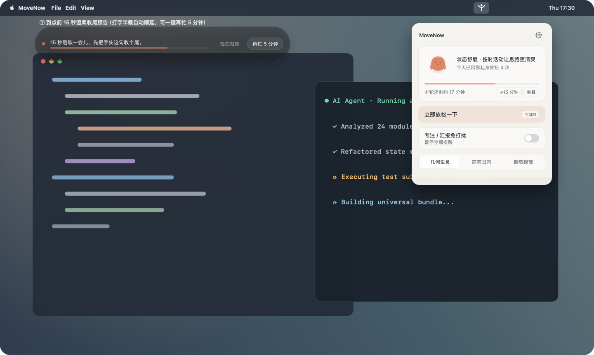
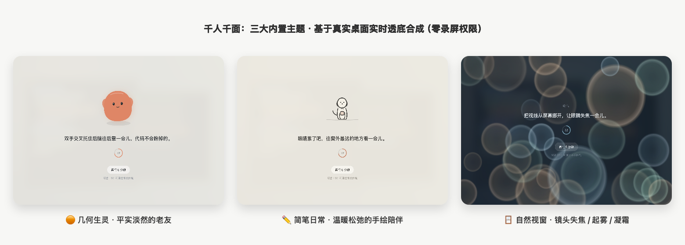
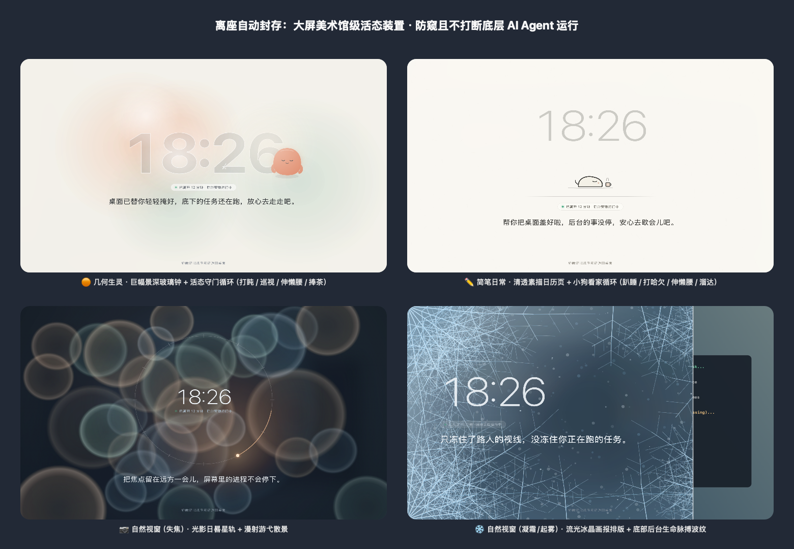

<div align="center">

# MoveNow · 动一下

**极懂分寸的桌面防久坐伙伴 —— 克制、耐看，真能把你从椅子上温柔劝起来**

[](#)
[](#)
[](#)
[](#)
[](LICENSE)

*A calm, thoughtful break companion that knows when to step back — and gently veils your workspace while you step away.*

</div>

<p align="center">
  
</p>

---

## 为什么做 MoveNow？

大多数休息提醒软件装上三天就会被关掉：**要么像闹钟一样随手按掉毫无用处，要么在正敲字、开会投屏时突然黑屏糊脸让人抓狂。**

**MoveNow** 用行为科学与克制审美重做每一个瞬间：平时安静待在右上角不跳读秒制造焦虑，打字半截绝不抢焦点，手头救火时连推三次自动识趣退让 1 小时；当你真正起身离开工位时，顺手替你遮好屏幕防窥，同时让底下的任务照常运行。

---

## 🎨 千人千面：三大内置主题（零“屏幕录制”敏感权限）

告别廉价卡通贴图与纯黑假墙，所有主题均基于 macOS 原生窗口实时透底模糊合成，平实克制、不卖萌不说教：

<p align="center">
  
</p>

- **🟠 几何生灵（默认）**：温润低饱和北欧磨砂小圆石，示范双手托后脑后仰、沉肩舒展与丰富肢体放松律动。
- **✏️ 简笔日常**：极简一笔画手绘线条小狗，侧身伸懒腰、望远透气、轻快舒展。
- **🪟 自然视窗**：无角色纯粹物理光学视窗，内置 **🌿 窗棂树影 / 🌧️ 晨雾玻璃 / ❄️ 寒霜晶花** 三种质感自由切换或轮换。

---

## 🛡️ 顺手解决离座痛点：防窥封存 × 不打断后台任务

起身去茶水间走开几分钟时，不用再纠结“不锁屏怕路人瞄见聊天与代码，按系统锁屏又打断心流或掐断后台任务”：

<p align="center">
  
</p>

- **大屏动态装置，护眼不晃眼、同事路过会心一笑**：休息倒计时归零若你尚未回座，自动滑入与当前主题气质合一的**全屏因果叙事封存舞台**（浅色系专门调校为 84% 无背光电纸书暖灰明度，大屏绝不刺眼；不显示暴露隐私的离开时长，每 10 分钟柔和轮换大方得体的工位微幽默文案）：
  - **🟠 几何生灵**：巨幅景深透叠玻璃时钟，圆润生灵基于**单一连续骨骼**演绎 **144 套（>2.5 小时零重复）** 全屏因果小剧目——失重漂浮、三色叠罗汉、五色同伴波浪列车、跨屏抛接光球；
  - **✏️ 简笔日常**：通透暖宣纸素描舞台，纯粹一笔画线条小狗与柴犬、腊肠、贵宾、小梗犬等同伴演绎 **144 套专属日常故事**——追折纸飞机、吹散蒲公英、踩墨水留爪印、五犬排队巡游；
  - **🪟 自然视窗**：**窗棂树影**投射斜阳百叶光束、摇曳树影与丁达尔浮尘；**晨雾玻璃 / 寒霜晶花**呈现凝露滑落与六角冰晶极光——遮蔽桌面防窥的同时，底下的 **AI Agent、终端编译与长任务照常推进**；
  - **🖥️ 多显示器空间呼应**：自动识别左右并排与上下叠放多屏拓扑——主屏作为主角大本营，副屏呈现同材质 **10 秒慢呼吸远景**（折纸飞机与蒲公英 / 双色呼吸光晕与陪睡小绿石 / 贯通高窗树影），主角与伙伴还会跨过屏幕边框去副屏串门再原路返回。
- **一碰即融 + 自适应两阶段电源保活**：回到座位轻触键鼠 **0.8 秒丝滑消散**，焦点无缝归还原窗口。开启「封存期防锁屏与后台保活」后自动感知插电/电池与全局断言：暂离防自动锁屏（插电 2h / 电池 25m），超时礼貌熄屏并转入后台任务续保（低电量自动释放）。

---

## 🧠 行为科学驱动的 5 个懂事细节

| 场景痛点 | MoveNow 的分寸设计 |
| :--- | :--- |
| **拼音选词 / 句子打到一半被打断** | **敲字顺延**：检测到手指正在连续敲击键盘，默默多等几秒直到停顿再切入 |
| **赶死线救火时反复弹窗惹人烦** | **福格模型退让**：随时一键「再忙 5 分钟」；连续推迟满 3 次自动静默免打扰 1 小时 |
| **停下鼠标却顺手低头刷手机** | **JTBD 动作替代**：优先引导双手托后脑、背手展胸、端杯接水，自然占住双手防摸手机 |
| **投屏汇报或安静办公室社死** | **自动避让 + 默认静音**：镜像投屏/全屏演示自动静默，一级面板直出免打扰，全局默认静音 |
| **刚去过洗手间回来又弹提醒** | **空闲与锁屏感知**：电脑锁屏、休眠或平时离开座位超过阈值，自动重算新一轮时间 |

---

## 🚀 快速安装（macOS）

零第三方依赖，使用 macOS 自带 Swift 工具链 **3 秒本地原生构建**（自动兼容 Apple Silicon 与 Intel，天然免除网传未公证安装包的系统拦截弹窗）。

### 方式一：🤖 复制一句话交给你的 AI Agent 自动安装（推荐）

直接发给你的 **Claude Code / Antigravity / Cursor / Codex**：

```text
请帮我克隆 https://github.com/xjzc-mt/move-now.git ，运行仓库里的 ./scripts/install.sh 编译安装 MoveNow.app 到应用程序目录并启动它。
```

### 方式二：终端两行命令一键安装

```bash
git clone https://github.com/xjzc-mt/move-now.git && cd move-now
./scripts/install.sh
```

<details>
<summary>开发者手动构建与单元测试</summary>

```bash
./scripts/build.sh && open build/MoveNow.app
node --test tests/state-machine.test.mjs
```
</details>

---

## 🗺️ 路线图与开源协议

- [x] **macOS 原生轻量常驻应用**（`MoveNow.app`）
- [ ] **Windows 支持**（跨平台主题与状态机核心已解耦，即将适配 WebView2 + Acrylic/Mica）
- [ ] **麦克风/摄像头会议状态自动联动**

基于 [MIT License](LICENSE) 开源，欢迎 Star ⭐️ 与 PR 贡献新的视窗主题！
